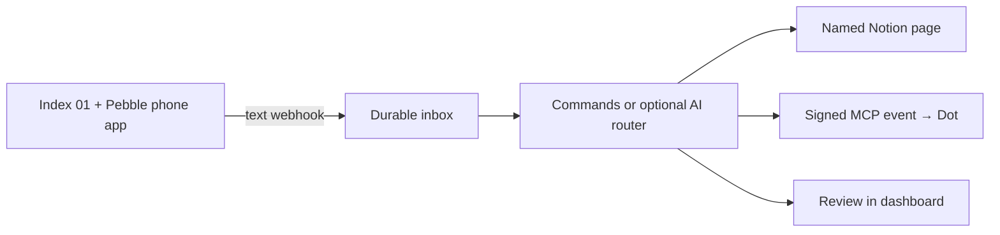

# Index Dispatch

A small, self-hosted gateway that turns Index 01 voice notes into saved notes or tasks for your OpenAI Dot.

**V1 prototype:** named Notion pages, Dots event delivery, an inbox for delivery status and manual review, and optional AI routing. Live account integration still needs deployment and verification. One owner, one subscribed Dot, one server process.



## What you can say

| Voice input | Result |
|---|---|
| “Note to ideas: a travel journal with voice entries” | Append to the configured `ideas` Notion page |
| “Dots, research a three-day Kyoto itinerary” | Queue a task and send it to the connected Dot |
| “Remember that the prototype needs larger buttons” | Save to `inbox` in command mode |
| “Research a three-day Kyoto itinerary” | Can route to Dots in optional AI mode |
| “Hey Kiro, check my eBay and Alibaba deliveries before my trip” | Send the request to the connected Dot |
| “Check my email for the receipt and compare delivery with my calendar” | Route to Dots in AI mode |

Command mode is the default and needs no model API key. It understands `Dots, …`, `ask Dots …`, and `note to NAME: …` / `note in NAME: …`. The colon or comma after a note destination is required. Other text becomes a note in the default destination. Unknown explicit destinations wait for review.

`DOTS_AGENT_ALIASES` adds comma-separated names for the same connected Dot (default `kiro,hiro`, including the common transcription variant). Addressing one of these names, optionally after “hey”, “hi” or “hello”, routes directly to Dots without a classifier call. Set the aliases to your own assistant's name; `Dots` always works.

Set `ROUTER_MODE=jev` and `TYPESAFE_API_KEY` (or `JEV_API_KEY`) to route with [Jev](https://docs.typesafe.ai/introduction/quickstart). `JEV_MODEL` defaults to `jev-latest`. Jev selects a configured Notion page, Dots, or review; the original transcript is preserved. Results below `JEV_MIN_CONFIDENCE` (default `0.75`) go to review. Built-in descriptions cover `inbox`, `ideas` and `journal`; customize any configured destination with `NOTE_DESTINATION_DESCRIPTIONS`, a JSON alias → description mapping. Note content is sent to TypeSafe when using Jev.

AI routing treats Dots as a personal assistant with connected email and calendar tools. Requests to check orders, find messages, check availability, schedule, research or plan belong to Dots, including multiple questions for that assistant. Missing dates or order numbers are for the assistant to look up or clarify. Routing does not grant tool permissions or guarantee a connection; the Dot handles its normal permissions and confirmations. Explicit note-saving requests and observations remain notes. Unknown destinations, unsupported smart-home control, genuinely unclear intent, and mixed Notion-save/assistant requests wait for review. The dashboard records Jev's selected destination and confidence, including whether the review was caused by the confidence threshold.

Alternatively, set `ROUTER_MODE=openai`, `OPENAI_API_KEY`, and a structured-output-capable `ROUTER_MODEL` to classify ordinary language. Explicit commands still take priority. Ambiguity, unsupported actions and classifier failures go to review. Semantic classification can make mistakes; start with explicit commands. No smart-home actions or other agent adapters ship in this version.

Notion notes appear as one bullet per recording beneath a `YYYY-MM-DD` heading. Notes for the same day reuse that section, including after a restart; later days get a new heading. `NOTION_TIMEZONE` controls the calendar date (default `UTC`; use `America/Los_Angeles` for Pacific time). The recording timestamp takes priority over the time the server received it. IDs stay in the dashboard rather than appearing after every note. Existing paragraphs are not automatically rewritten.

## Hosting recommendation

**Railway Hobby** fits this version: one Docker service plus one persistent volume. Its $5 monthly minimum includes $5 of usage; usage above that is additional. Budget roughly $5–10/month initially, then inspect measured usage. Optional model calls and third-party subscriptions are separate. [Railway pricing](https://railway.com/pricing).

Render with a paid service and persistent disk is another portable option. Cloudflare Workers can be economical, but this Python/SQLite worker would require a different storage and job design. Railway keeps this first version simple while the Docker image remains portable.

Follow [DEPLOY.md](DEPLOY.md). Do not enable replicas or multiple Uvicorn workers: SQLite and the job runner are intentionally single-process. Attach durable storage before accepting real notes.

## Local development

Python 3.14 is the tested runtime.

```sh
python3 -m venv .venv
. .venv/bin/activate
pip install -r requirements-dev.txt
python scripts/configure.py
# Edit .env, then export its variables in this shell:
set -a
. ./.env
set +a
uvicorn app.main:create_app --factory --host 127.0.0.1 --port 8787 --no-access-log
```

Open `http://127.0.0.1:8787`. Use `ADMIN_TOKEN` from your private `.env` to open the inbox. Without a Notion configuration, notes are retained for review; Dots tasks wait for a subscription. You can inspect the flow before connecting external services.

```sh
python -m pytest -q
ruff check .
ruff format --check .
```

Tests use isolated databases and mocked external services. They exercise real HTTP request handling, OAuth/PKCE and token rotation, multipart Index input, Notion payloads, event verification/signing, ownership, retries and recovery. They do **not** establish live compatibility with a particular ChatGPT workspace or Notion account.

## Delivery guarantees and limits

- Index input is text only, up to 12,000 characters / 64 KiB total request. Configure the Pebble webhook to omit audio.
- Duplicate Index requests with the same transcript and `recordedAt` are coalesced. Clients without a timestamp should use `Idempotency-Key`; otherwise each submission is a new request.
- SQLite commits before acknowledging receipt. Transcripts, decisions and results are stored in the volume. Subscription secrets are encrypted with `ENCRYPTION_KEY`; transcript data is not encrypted by the app.
- Dots deliveries retry transient errors with a stable event ID and bounded backoff. A `delivered` task was accepted by ChatGPT, not necessarily handled. The Dot calls `report_task_result` with `in_progress` before working, `needs_input` when awaiting your answer/approval, and `completed` or `failed` after responding. Timestamps persist across restarts. Duplicate reports are idempotent, and a late progress report cannot overwrite a final result.
- The dashboard refreshes every 15 seconds. It flags **No response yet** after `DOTS_ACK_TIMEOUT_SECONDS` (default 300), **No recent update** after `DOTS_PROGRESS_TIMEOUT_SECONDS` (default 1800), and **Waiting for you** when the Dot requests input. Older deliveries with no acknowledgment history show **Handling unconfirmed**. These indicate missing confirmation, not proof that the agent failed. Inspect the chat with the displayed task ID before retrying; overdue requests are never automatically resent.
- This is at-least-once delivery. The Dot should use task IDs to avoid repeating work. Exactly-once external agent execution is not guaranteed.
- Notion lacks an app-level idempotency transaction here. Ambiguous writes pause for manual review. Check the note text and date on the destination page against the request in the dashboard before approving a retry.
- One live Dots subscription is supported. Expired subscriptions stop delivery; queued tasks wait. Events have no protocol replay cursor. Already acknowledged events are not automatically resent.
- Authorization is single-owner OAuth with PKCE, explicit redirect allowlists, short-lived access tokens, rotating refresh tokens and admin revocation. It is not a general-purpose multi-tenant identity service.
- Callback host allowlists, public-IP validation on each connection, TLS hostname verification, no redirects and signed webhooks protect event delivery. Set a perimeter rate limit for public deployments; built-in rate limits are global and deliberately modest.
- Pebble's phone app remains part of capture/transcription delivery. Its webhook runs alongside the default agent; configure workflows to avoid duplicate downstream actions. This is independent routing, not replacement ring firmware or a fully offline capture stack. [Pebble documentation](https://help.repebble.com/en/articles/15724406-index-advanced-features-mcp-webhook).

## Modules

`app/router.py` decides a destination. `app/delivery.py` contains transport/adapters. `app/worker.py` handles durable delivery states. `app/mcp.py` exposes Dots events and result tools. `app/auth.py` owns connection authentication. Other agents can be added as destination adapters without changing Index ingestion; multiple agents will also need a destination registry and per-agent subscription queues.

Endpoints: `POST /webhooks/index` (Index bearer token), `/api/*` (admin bearer token), `POST /mcp` (OAuth), `/oauth/*`, `/healthz`, and `/` for the dashboard. The MCP endpoint offers stateless JSON responses, MCP 2.0 event discovery and legacy tool initialization; no SSE stream is required.

See [the Dots setup prompt](docs/dots-setup.md), [security and operations](SECURITY.md), and [integration references](docs/references.md).
